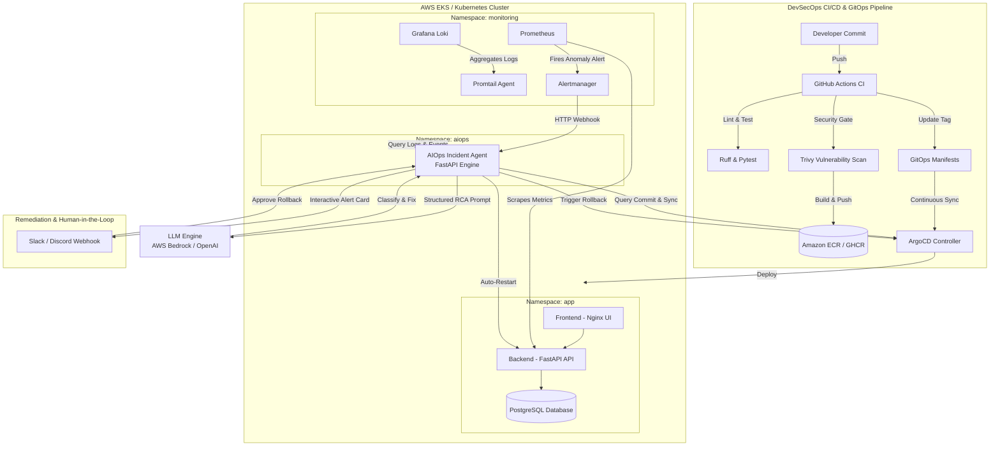
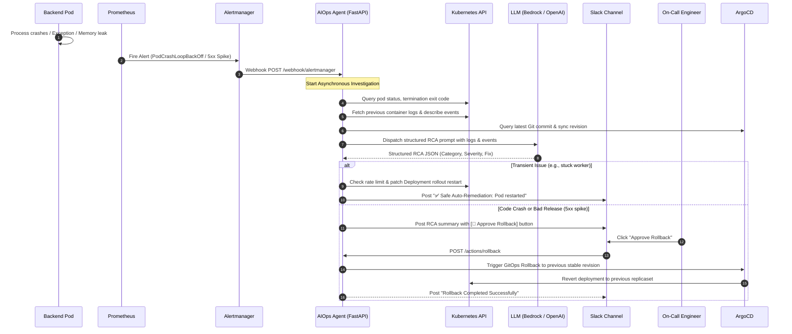

# 🛡️ Self-Healing Multi-Tier Microservices Platform with GitOps & AIOps

[](.github/workflows/ci-devsecops.yaml)
[](terraform/)
[](k8s/)
[](k8s/argocd/)
[](.github/workflows/ci-devsecops.yaml)
[](aiops-agent/)

A production-grade, GitOps-driven, self-healing cloud platform built on **AWS EKS**, automated entirely with **Terraform**, synchronized via **ArgoCD (App-of-Apps)**, secured with **Trivy vulnerability gates**, and instrumented with an autonomous **AIOps Incident Triage & Remediation Bot** powered by Python FastAPI and Large Language Models (AWS Bedrock / OpenAI).

---

## 🎯 The Engineering Problem & AIOps Solution

### The Old Way: Alert Fatigue & Slow MTTR
In traditional operations, when a pod crashes (`CrashLoopBackOff`) or encounters an unhandled exception, Prometheus fires a generic alert to Slack or PagerDuty. Engineers get woken up at 3:00 AM, log into bastion hosts, run `kubectl get pods`, copy logs, search GitHub commit history, determine if it was a transient blip or bad deploy, and manually issue commands. Mean Time to Resolution (MTTR) is typically 15–45 minutes.

### The AIOps Autonomous Platform:
Instead of sending noisy raw alerts, this platform introduces an **Automated Incident Triage & Remediation Engine**:
1. **Anomaly Detection:** Prometheus detects an anomaly (CrashLoopBackOff, OOMKilled, or 5xx spike) and fires an Alertmanager webhook.
2. **Context Gathering:** A lightweight FastAPI webhook receiver immediately intercepts the event, queries the Kubernetes API and Loki for recent pod logs (inspecting previous crashed instances), collects `kubectl describe` events, and fetches current Git commit hashes from ArgoCD.
3. **AI Root-Cause Analysis (RCA):** The agent feeds runtime context, logs, and Git metadata to an LLM (AWS Bedrock Claude 3.5 or OpenAI) with a structured system prompt, extracting root causes, categories, severity, and exact remediation commands.
4. **Action & Safe Self-Healing:**
   - **Safe Auto-Remediation:** For transient infrastructure failures (e.g. hung worker or transient lock), it safely restarts the deployment via Kubernetes API with built-in rate-limiting.
   - **Code / Release Bugs:** For application exceptions or bad releases, it dispatches an actionable Slack Block Kit card complete with root-cause summaries and a **one-click "Approve Rollback" button**, triggering an immediate ArgoCD rollback without human terminal access.

---

## 🏗️ Architecture & High-Level Design

### 1. High-Level Platform Architecture



---

### 2. AIOps Triage & Self-Healing Sequence Diagram



---

## 📂 Repository Structure

```text
.
├── app/
│   ├── frontend/                 # Tier 1: Nginx web UI with Chaos Engineering control panel
│   │   ├── index.html
│   │   ├── nginx.conf
│   │   └── Dockerfile            # Hardened non-root image
│   ├── backend/                  # Tier 2: FastAPI microservice with metrics & chaos hooks
│   │   ├── main.py
│   │   ├── requirements.txt
│   │   └── Dockerfile            # Multi-stage python-slim image (non-root UID 10001)
│   └── docker-compose.yml        # Local development testbed
├── terraform/                    # Infrastructure as Code
│   ├── modules/
│   │   ├── vpc/                  # Multi-AZ VPC, Public/Private subnets, NAT Gateway, EKS tags
│   │   ├── eks/                  # Managed EKS, Spot node groups, OIDC Provider for IRSA
│   │   └── ecr/                  # Repositories with vulnerability scanning & lifecycle policies
│   └── environments/
│       └── dev/                  # Dev environment root module with remote state locking
├── k8s/
│   ├── helm-charts/              # Production Helm charts
│   │   └── microservices-app/    # Deployments, Services, Ingress, HPA, StatefulSet
│   ├── argocd/                   # GitOps App-of-Apps manifests
│   │   ├── application-root.yaml
│   │   ├── app-microservices.yaml
│   │   ├── app-observability.yaml
│   │   └── app-aiops.yaml
│   └── observability/            # PrometheusRules, Alertmanager webhook values, Loki config
│       ├── kube-prometheus-stack-values.yaml
│       └── prometheus-rules.yaml
├── aiops-agent/                  # Core Autonomous Incident Triage & Self-Healing Service
│   ├── app/
│   │   ├── main.py               # FastAPI webhook & rollback endpoints
│   │   ├── config.py             # Pydantic Settings
│   │   ├── models.py             # Pydantic schemas for Alertmanager & RCA
│   │   ├── k8s_client.py         # Official Kubernetes Python client (events, logs, restarts)
│   │   ├── loki_client.py        # Grafana Loki REST log query client
│   │   ├── gitops_client.py      # ArgoCD REST API rollback client
│   │   ├── llm_analyzer.py       # Bedrock Claude / OpenAI / Heuristic RCA engine
│   │   ├── notification.py       # Slack Block Kit & Discord interactive card builder
│   │   └── remediation.py        # Safety engine (rate limits, auto-restart vs approval)
│   ├── k8s/                      # Agent Deployment, Service, and least-privilege RBAC
│   ├── tests/                    # Pytest test suite with realistic Alertmanager payloads
│   └── Dockerfile
├── .github/workflows/            # DevSecOps CI/CD
│   ├── ci-devsecops.yaml         # Lint, test, Docker build, Trivy vulnerability gate
│   ├── gitops-sync.yaml          # Auto-update Helm values image tags upon CI pass
│   └── terraform-ci.yaml         # Terraform fmt, validate, and Trivy IaC scan
├── scripts/                      # Developer & Demo Automation
│   ├── setup-local.ps1 / .sh     # Automated local Kind cluster bootstrap
│   ├── simulate-crash.ps1 / .sh  # 1-Click fault injector for interviews/demos
│   └── teardown.ps1 / .sh        # Clean resource teardown
└── README.md
```

---

## 🛠️ Tech Stack & Engineering Justifications

| Layer | Tools | Why This Tool? |
| :--- | :--- | :--- |
| **Cloud & IaC** | AWS (VPC, EKS, ECR, IAM) + Terraform | Modular Terraform ensures reproducible environments; remote state locking via DynamoDB prevents concurrency conflicts. Spot instance node groups reduce AWS costs by up to 70%. |
| **Application** | FastAPI, Nginx, PostgreSQL | High-performance asynchronous API, lightweight static frontend, and ACID-compliant relational storage. Includes `/metrics` for Prometheus and chaos endpoints for fault injection. |
| **GitOps** | ArgoCD (App-of-Apps) | Eliminates `kubectl apply` drift. Git is the single source of truth; updates to the repository automatically synchronize across the cluster with zero manual intervention. |
| **DevSecOps** | GitHub Actions + Aquasecurity Trivy | Every pull request is scanned for filesystem vulnerabilities and container CVEs. Builds are strictly blocked if CRITICAL unpatched vulnerabilities exist. |
| **Observability** | Prometheus, Alertmanager, Grafana, Loki | Prometheus monitors pod metrics and error rates. Alertmanager fires webhooks to the AIOps engine. Loki stores logs accessible via API for automated crash context retrieval. |
| **AIOps Engine** | Python FastAPI, Kubernetes SDK, Bedrock/OpenAI | Event-driven webhook processing with native Kubernetes client bindings. Evaluates logs and kubectl describe events using LLM structured outputs to eliminate alert fatigue. |

---

## 🚀 Quickstart Guide

### Option A: Local Zero-Cost Testing (Recommended for Exploration & Demos)

You can run the entire platform locally on **Docker & Kind** without spending any cloud budget.

#### 1. Quick Docker Compose (App & DB only)
```bash
cd app
docker compose up --build
```
Access the dashboard at `http://localhost:8080` and backend API docs at `http://localhost:8000/docs`.

#### 2. Full Local Kubernetes Cluster (with Ingress, Helm & AIOps Agent)
Run our automated bootstrap script:
```powershell
# On Windows PowerShell:
.\scripts\setup-local.ps1

# On Linux / macOS:
chmod +x ./scripts/setup-local.sh
./scripts/setup-local.sh
```

#### 3. Test the AIOps Agent Directly
```powershell
cd aiops-agent
python -m venv venv
.\venv\Scripts\Activate.ps1
pip install -r requirements.txt
uvicorn app.main:app --port 8000 --reload
```

---

### Option B: Production AWS EKS Deployment

#### 1. Configure AWS Credentials & S3 Backend
Ensure you have the AWS CLI configured:
```bash
aws sts get-caller-identity
```

#### 2. Initialize and Deploy Terraform
```bash
cd terraform/environments/dev
cp terraform.tfvars.example terraform.tfvars
terraform init
terraform plan
terraform apply -auto-approve
```

#### 3. Connect kubectl to EKS
```bash
aws eks --region us-east-1 update-kubeconfig --name aiops-dev-eks
kubectl get nodes
```

#### 4. Bootstrap ArgoCD & GitOps App-of-Apps
```bash
kubectl create namespace argocd
kubectl apply -n argocd -f https://raw.githubusercontent.com/argoproj/argo-cd/stable/manifests/install.yaml
kubectl apply -f k8s/argocd/application-root.yaml
```

---

## 🧪 Live Chaos Engineering & AIOps Demo Scenarios

The platform includes simulated chaos scenarios designed for live recruiter demonstrations and portfolio reviews.

### Scenario 1: CrashLoopBackOff & Safe Auto-Remediation
1. **Trigger:** A transient fault or worker deadlock crashes the container.
2. **Execute simulation:**
   ```powershell
   .\scripts\simulate-crash.ps1 -Scenario crash
   ```
3. **What the Bot Does:**
   - Detects `PodCrashLoopBackOff`.
   - Inspects previous container logs via Kubernetes API.
   - Diagnoses cause as `TRANSIENT_INFRA`.
   - Checks the rate-limiting safeguard (max 3 restarts/hour).
   - Automatically executes a rolling restart: `k8s_client.restart_deployment(...)`.
   - Sends a notification confirming resolution.

---

### Scenario 2: Memory Leak (OOMKilled)
1. **Trigger:** A memory-intensive endpoint consumes more than the 256Mi container limit.
2. **Execute simulation:**
   ```powershell
   .\scripts\simulate-crash.ps1 -Scenario oom
   ```
3. **What the Bot Does:**
   - Captures `exit_code: 137` and Linux kernel `OOMKilled` event.
   - Classifies category as `OOM_MEMORY_LEAK` with high confidence (0.96).
   - Generates exact fix recommendation: *Update `values.yaml` memory limits to 512Mi*.

---

### Scenario 3: Bad Code Release & Human-in-the-Loop Rollback
1. **Trigger:** A new release causes unhandled 500 errors or syntax exceptions.
2. **Execute simulation:**
   ```powershell
   .\scripts\simulate-crash.ps1 -Scenario 5xx
   ```
3. **What the Bot Does:**
   - Intercepts `ServiceHigh5xxRate`.
   - Matches the failure to the latest Git commit hash retrieved from ArgoCD.
   - Determines that automated restart **will not fix a code bug** and would cause a restart storm.
   - Generates an actionable Slack card with an interactive **"🚀 Approve Rollback (ArgoCD)"** button.
   - When the engineer approves, the bot triggers the ArgoCD rollback API, immediately restoring the stable replica set.

---

## 🔒 DevSecOps & Security Hardening

- **Non-Root Containers:** All container images (backend, frontend, and AIOps agent) run as non-root unprivileged users (`UID 10001` / `10002`).
- **Read-Only / Least Privilege RBAC:** The AIOps agent is bound to a dedicated `ClusterRole` that permits only read operations on pods, logs, and events, and restricts write operations exclusively to `patch` on deployments.
- **Trivy Vulnerability Gates:** GitHub Actions automatically blocks container image pushes if any `CRITICAL` Common Vulnerabilities and Exposures (CVEs) with available fixes are discovered.
- **Cost Protection Lifecycles:** ECR repositories automatically purge untagged development images older than 7 days and retain only the last 10 tagged releases.

---

## 🎤 Interview Defense & Architecture Q&A

### 1. "Why build a custom AIOps bot instead of relying solely on Kubernetes native restart policies?"
> **Answer:** Kubernetes native restart policies (`RestartPolicy: Always`) are blind to root causes. If an issue is caused by a bad code release or missing environment variable, Kubernetes will repeatedly restart the container into a `CrashLoopBackOff` loop, potentially overwhelming downstream databases and triggering cascading failures. Our AIOps agent gathers contextual logs, exit codes, and Git metadata to distinguish between transient glitches (safe to restart) and code bugs (where restarts are suppressed and a GitOps rollback is recommended).

### 2. "How does the bot prevent 'restart storms' or endless restart loops?"
> **Answer:** The remediation engine enforces an in-memory sliding-window rate limiter (`MAX_AUTO_RESTARTS_PER_HOUR = 3`). If a service crashes more than 3 times within an hour, the auto-restart action is automatically locked, and the incident is escalated to human engineers with full diagnostics.

### 3. "Why require Human-in-the-Loop for rollbacks instead of rolling back automatically?"
> **Answer:** Automated rollbacks carry a blast radius—for instance, if a rollback breaks database schema migrations or disconnects active stateful sessions. By performing AI root-cause analysis and presenting a 1-click approval button in Slack, we reduce MTTR from 30 minutes to 10 seconds while maintaining human oversight and compliance.

---

## 🧹 Teardown

To avoid incurring ongoing cloud costs when testing on AWS:
```powershell
# Destroy AWS Terraform Infrastructure:
.\scripts\teardown.ps1 -Cloud

# Or clean up local Kind cluster:
.\scripts\teardown.ps1 -Local
```

---

**Author:** Cloud & DevOps Platform Engineer  
**Portfolio:** [madan.me](https://madan.me)  
**License:** MIT
